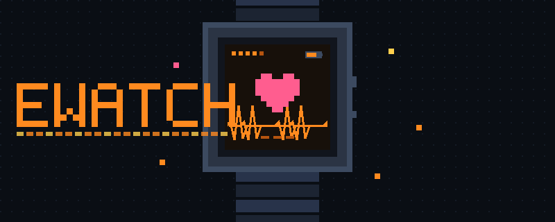

  

# EWatch

Firmware and apps for the **EWatch**, a custom ESP32-S3 smartwatch.

More at **[ewanwills.co.uk/ewatch](https://www.ewanwills.co.uk/ewatch)**.

Each folder is a complete, standalone PlatformIO firmware: flash one and it's the
whole watch. Every project has its own README with build and flashing notes.

## Operating systems

| Folder | What it is |
| --- | --- |
| [`EWatchOS2.1`](EWatchOS2.1) | The unified firmware: every app in one build, with a modern GUI, control centre and five watch faces |
| [`FirstOS`](FirstOS) | The original EWatch firmware |
| [`FirstOS Fable`](FirstOS%20Fable) | FirstOS with tiered power management, logging and duty-cycled WiFi |
| [`BaseOS`](BaseOS) | A bare-bones slate with every driver and the system shell, but no apps. Start here to build your own (see `BaseOS/CLAUDE.md`) |

## Watch faces

| Folder | What it is |
| --- | --- |
| [`BasicDigital`](BasicDigital) | Minimal digital watch face |
| [`BasicAnalog`](BasicAnalog) | Minimal analog watch face |
| [`3D_Watchface`](3D_Watchface) | A low-poly floating-island diorama that tells the time |
| [`ScrubMarine`](ScrubMarine) | ScrubMarine-branded watch face and screensaver |
| [`ClaudeFace`](ClaudeFace) | A Claude Code status face, fed over USB-C by a desktop bridge |

## Games and apps

| Folder | What it is |
| --- | --- |
| [`3D_Racer`](3D_Racer) | OutRun-style pseudo-3D racer. Tilt to steer |
| [`Tunnel_Racer`](Tunnel_Racer) | Endless wireframe tunnel runner. Tilt to line up with the gaps |
| [`Starfox_shooter`](Starfox_shooter) | On-rails wireframe space shooter with boss waves |
| [`Doom`](Doom) | Doom on your wrist |
| [`tamagotchi`](tamagotchi) | A virtual pet |
| [`Spotify_Controller`](Spotify_Controller) | Spotify now-playing viewer and remote |

## Licence

MIT. See [LICENSE](LICENSE).
